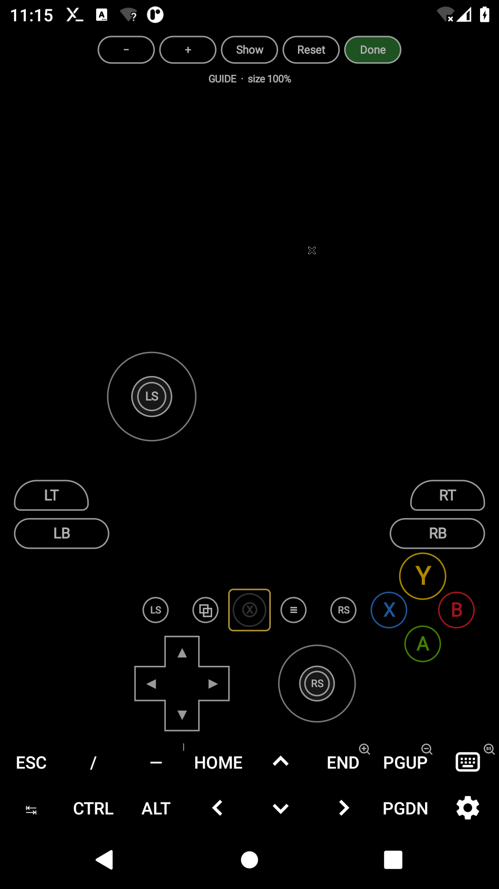

# termux-x11 with onscreen Xbox gamepad

Ready-to-install APK: [`apk/termux-x11-xbox-gamepad.apk`](apk/termux-x11-xbox-gamepad.apk)
(standalone `com.termux.x11` debug build, signed with upstream's test key, so it installs over the official nightly builds).

Built from upstream [termux/termux-x11](https://github.com/termux/termux-x11) commit `7e5f5c5` plus
[`patches/termux-x11-xbox-gamepad.patch`](patches/termux-x11-xbox-gamepad.patch). Rebuild with `./build.sh`.


## Install

1. Install `apk/termux-x11-xbox-gamepad.apk`. If another Termux:X11 build is installed with a different signature, uninstall it first.
2. **In Termux, install the matching companion package** (the `termux-x11` command must be the same version as the app, otherwise the app can crash or fail to connect):
   ```
   pkg remove termux-x11-nightly   # if installed
   dpkg -i termux-x11-nightly-1.03.01-0-all.deb
   ```
   ([`apk/termux-x11-nightly-1.03.01-0-all.deb`](apk/termux-x11-nightly-1.03.01-0-all.deb)). Don't `pkg upgrade` it back to the repo version.
3. Start as usual: `termux-x11 :0 &`.

## Usage

Preferences → **Onscreen gamepad** → enable **Show onscreen gamepad**. The 🎮 button at the top center collapses/expands the pad.
You can also toggle it with a `GAMEPAD` key in the extra keys bar, or the `toggle onscreen gamepad` action (swipe, back button, volume keys).

Controls: LS / RS analog sticks, LS / RS click buttons, D-pad (8-way), A B X Y, LB RB, LT RT, View, Guide, Menu.
Touches that miss the pad still go to the X desktop. The pad moves up automatically so the extra keys bar doesn't cover it.

### Customizing the layout

Long-press the 🎮 button (or use a `GAMEPAD_EDIT` key in the extra keys bar) to enter the layout editor:

- drag any control to move it;
- tap a control to select it, then **−** / **+** to resize it (50–250 %), **Hide** / **Show** to remove or bring it back;
- **Reset** restores the selected control, **Reset all** (nothing selected) restores the default layout;
- **Done** saves. The layout is kept across restarts.



Settings: size, opacity, left/right stick mode (`keys`, `mouse`, `none`), stick mouse speed, vibration, button mapping.

## Real Xbox controller mode (Wine games)

Games running in Wine can see the onscreen pad as a **real Xbox 360 controller**: analog sticks, every button
including Guide, and the game's rumble vibrating the phone. It works without root through
[`xinput-bridge`](xinput-bridge/), replacement `xinput1_3/1_4/9_1_0.dll`s that get the pad's state from the
app over UDP on `127.0.0.1:7949`.

1. In Termux (or wherever you run Wine), get the bridge and install it into your Wine prefix:
   ```
   curl -LO https://github.com/HarryL0L/testing-purpose-only/raw/claude/termux-x11-xbox-gamepad-imz9pn/apk/xinput-bridge.zip
   unzip xinput-bridge.zip && cd xinput-bridge
   ./install.sh ~/.wine            # your WINEPREFIX; with box64 e.g.: WINE="box64 wine64" ./install.sh ~/.wine
   ```
   It copies the 64-bit DLLs to `system32`, the 32-bit ones to `syswow64` (originals kept as `.orig`) and sets
   the DLLs to *native, builtin*. `./install.sh --uninstall ~/.wine` undoes it. If your launcher has its own
   DLL override setting (e.g. winecfg → Libraries), `xinput1_3`, `xinput1_4`, `xinput9_1_0` must be *native, builtin*.
2. In Termux:X11: Preferences → **Onscreen gamepad** → **Gamepad sends** → `xbox controller`.
3. Start the game. It finds the controller as soon as the onscreen pad is shown.

In this mode the button mapping and stick modes don't apply: the game gets the controller itself, and you set
the controls in the game. Triggers are digital (fully pressed or released).
Only games using XInput (most games since ~2007) see it; old DirectInput-only games don't.

## Mapping (keyboard and mouse mode)

X11 has no virtual joystick device, so the pad sends keyboard keys and mouse input. Default (FPS style):

| Control | Sends | Control | Sends |
|---|---|---|---|
| Left stick | W A S D | Right stick | mouse movement |
| A | Space | B | C |
| X | R | Y | E |
| LB | Q | RB | F |
| LT | right mouse button | RT | left mouse button |
| View | Tab | Menu | Escape |
| Guide | Enter | D-pad | arrow keys |
| LS click | Left Shift | RS click | V |

Change it with the **Button mapping** setting, e.g. `A=ENTER B=ESC LT=CTRL_LEFT+Z RS=WHEEL_UP`.
Names: `A B X Y LB RB LT RT VIEW MENU GUIDE LS RS DPAD_UP/DOWN/LEFT/RIGHT LS_UP/DOWN/LEFT/RIGHT RS_UP/DOWN/LEFT/RIGHT`
(stick directions are used when the stick mode is `keys`).
Values: any Android key name without the `KEYCODE_` prefix (`SPACE`, `F1`, `SHIFT_LEFT`, `1`, ...), aliases `ESC SHIFT CTRL ALT UP DOWN LEFT RIGHT`,
`MOUSE_LEFT MOUSE_RIGHT MOUSE_MIDDLE WHEEL_UP WHEEL_DOWN NONE`; join with `+` for combos. Unlisted controls keep their default.
