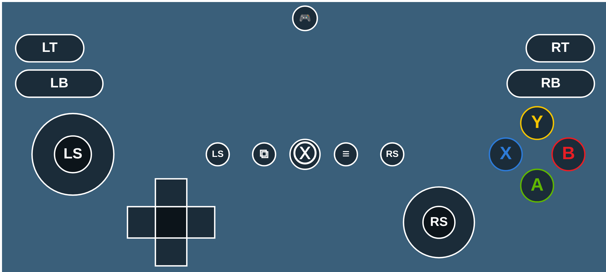

# termux-x11 with onscreen Xbox gamepad

Ready-to-install APK: [`apk/termux-x11-xbox-gamepad.apk`](apk/termux-x11-xbox-gamepad.apk)
(standalone `com.termux.x11` debug build, signed with upstream's test key, so it installs over the official nightly builds).

Built from upstream [termux/termux-x11](https://github.com/termux/termux-x11) commit `7e5f5c5` plus
[`patches/termux-x11-xbox-gamepad.patch`](patches/termux-x11-xbox-gamepad.patch). Rebuild with `./build.sh`.



## Install

1. Install `apk/termux-x11-xbox-gamepad.apk`. If another Termux:X11 build is installed with a different signature, uninstall it first.
2. **In Termux, install the matching companion package** (the `termux-x11` command must be the same version as the app, otherwise the app can crash or fail to connect):
   ```
   pkg remove termux-x11-nightly   # if installed
   dpkg -i termux-x11-nightly-1.03.01-0-all.deb
   ```
   ([`apk/termux-x11-nightly-1.03.01-0-all.deb`](apk/termux-x11-nightly-1.03.01-0-all.deb)). Don't `pkg upgrade` it back to the repo version.
3. Start as usual: `termux-x11 :0 &`.

## Usage

Preferences → **Onscreen gamepad** → enable **Show onscreen gamepad**. The 🎮 button at the top center collapses/expands the pad.
You can also toggle it with a `GAMEPAD` key in the extra keys bar, or the `toggle onscreen gamepad` action (swipe, back button, volume keys).

Controls: LS / RS analog sticks, LS / RS click buttons, D-pad (8-way), A B X Y, LB RB, LT RT, View, Guide, Menu.
Touches that miss the pad still go to the X desktop. The pad moves up automatically so the extra keys bar doesn't cover it.

Settings: size, opacity, left/right stick mode (`keys`, `mouse`, `none`), stick mouse speed, vibration, button mapping.

## Mapping

X11 has no virtual joystick device, so the pad sends keyboard keys and mouse input. Default (FPS style):

| Control | Sends | Control | Sends |
|---|---|---|---|
| Left stick | W A S D | Right stick | mouse movement |
| A | Space | B | C |
| X | R | Y | E |
| LB | Q | RB | F |
| LT | right mouse button | RT | left mouse button |
| View | Tab | Menu | Escape |
| Guide | Enter | D-pad | arrow keys |
| LS click | Left Shift | RS click | V |

Change it with the **Button mapping** setting, e.g. `A=ENTER B=ESC LT=CTRL_LEFT+Z RS=WHEEL_UP`.
Names: `A B X Y LB RB LT RT VIEW MENU GUIDE LS RS DPAD_UP/DOWN/LEFT/RIGHT LS_UP/DOWN/LEFT/RIGHT RS_UP/DOWN/LEFT/RIGHT`
(stick directions are used when the stick mode is `keys`).
Values: any Android key name without the `KEYCODE_` prefix (`SPACE`, `F1`, `SHIFT_LEFT`, `1`, ...), aliases `ESC SHIFT CTRL ALT UP DOWN LEFT RIGHT`,
`MOUSE_LEFT MOUSE_RIGHT MOUSE_MIDDLE WHEEL_UP WHEEL_DOWN NONE`; join with `+` for combos. Unlisted controls keep their default.
