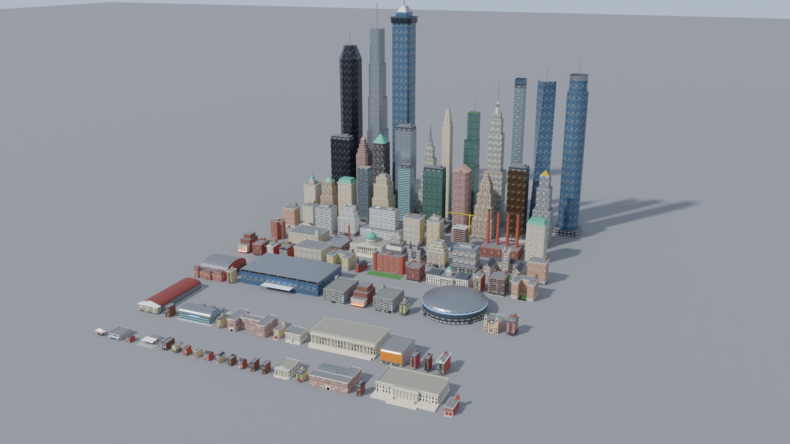
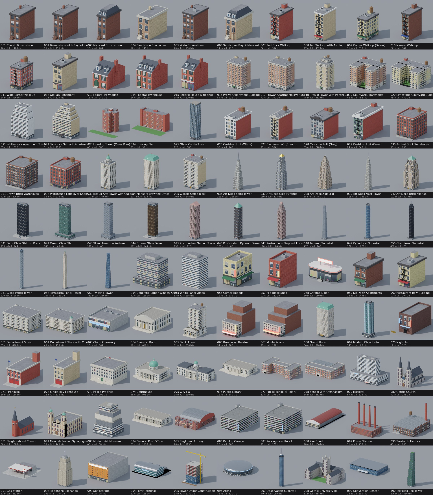

# Manhattan Building Kit — 100 game-ready buildings



100 low-poly, textured building types inspired by Manhattan's architecture, from
brownstones and walk-ups to Art Deco towers and glass supertalls. Every building is
generated procedurally with Blender's Python API, so you can tweak and regenerate the set.



## What's included

| Path | Contents |
|---|---|
| `models/*.glb` | One glTF binary per building (embedded JPEG textures). Works in Unity, Unreal, Godot, three.js and Blender. |
| `manhattan_kit.blend` | All 100 buildings in one Blender file, laid out on a grid (textures packed). |
| `previews/*.jpg` | A 480×480 preview of each building. |
| `catalog.json` | Metadata: id, name, category, size, triangle count, materials, file. |
| `textures/*.png` | The 83 procedural facade/surface textures. |
| `generator/` | The Python source used to make everything. |

## Specs

- **Units:** metres, real-world scale (rowhouse ≈ 16 m, supertall ≈ 470 m).
- **Pivot:** centre of the footprint at ground level (z = 0).
- **Orientation:** main facade faces **−Y** in Blender (exported glTF is Y-up, so the front faces **+Z** in glTF/Unity/Godot).
- **Geometry:** one mesh per building, flat-shaded, 31,534 triangles for all 100 (38–1,732 each, median ≈ 224).
- **Materials:** PBR metallic/roughness. Facade textures tile per bay and storey, so windows line up with floors and corners.
  Signs and lamps have emission.
- **Size on disk:** about 9 MB for all 100 GLBs (30–193 KB each).

Notes for game use:
- Textures use repeat wrapping and UVs outside 0–1. Keep the sampler on **Repeat** (the glTF default).
- There are no interiors and no LODs. Add colliders in-engine (a box collider fits most of these).
- All designs are generic archetypes. None reproduces a specific real landmark or trademark.

## Catalog

### Residential (25)

| # | Building | Size W×D×H (m) | Tris | File |
|---|---|---|---|---|
| 001 | **Classic Brownstone** — 4-storey brownstone rowhouse with stoop and cornice. | 7×16×16 | 148 | [`001_brownstone_classic.glb`](models/001_brownstone_classic.glb) |
| 002 | **Brownstone with Bay Window** — Brownstone with a three-sided oriel bay. | 7×16×16 | 156 | [`002_brownstone_baywindow.glb`](models/002_brownstone_baywindow.glb) |
| 003 | **Mansard Brownstone** — Brownstone topped with a slate mansard and dormers. | 7×16×18 | 204 | [`003_brownstone_mansard.glb`](models/003_brownstone_mansard.glb) |
| 004 | **Sandstone Rowhouse** — 3-storey light sandstone rowhouse. | 7×16×12 | 148 | [`004_sandstone_rowhouse.glb`](models/004_sandstone_rowhouse.glb) |
| 005 | **Wide Brownstone** — 5-storey double-width brownstone. | 10×18×20 | 180 | [`005_brownstone_wide.glb`](models/005_brownstone_wide.glb) |
| 006 | **Sandstone Bay & Mansard** — Light rowhouse with bay window and mansard roof. | 7×16×14 | 212 | [`006_sandstone_bay_mansard.glb`](models/006_sandstone_bay_mansard.glb) |
| 007 | **Red Brick Walk-up** — 5-storey walk-up with storefront and fire escape. | 9×20×24 | 394 | [`007_tenement_red.glb`](models/007_tenement_red.glb) |
| 008 | **Tan Walk-up with Awning** — 6-storey tan brick walk-up with awninged shop. | 10×20×27 | 462 | [`008_tenement_tan.glb`](models/008_tenement_tan.glb) |
| 009 | **Corner Walk-up (Yellow)** — Corner walk-up with shopfronts on two streets. | 12×22×31 | 530 | [`009_tenement_corner_yellow.glb`](models/009_tenement_corner_yellow.glb) |
| 010 | **Narrow Walk-up** — Slim 5-storey brown brick walk-up. | 8×18×24 | 342 | [`010_tenement_narrow.glb`](models/010_tenement_narrow.glb) |
| 011 | **Wide Corner Walk-up** — Wide 6-storey corner tenement. | 15×24×34 | 586 | [`011_tenement_corner_wide.glb`](models/011_tenement_corner_wide.glb) |
| 012 | **Old-law Tenement** — 4-storey tenement without fire escape, with shop. | 9×18×21 | 126 | [`012_tenement_oldlaw.glb`](models/012_tenement_oldlaw.glb) |
| 013 | **Federal Rowhouse** — 2.5-storey Federal-style house, dormers and chimneys. | 8×13×11 | 142 | [`013_federal_rowhouse.glb`](models/013_federal_rowhouse.glb) |
| 014 | **Federal Townhouse** — 3-storey Federal townhouse with gable roof. | 10×14×14 | 170 | [`014_federal_threestory.glb`](models/014_federal_threestory.glb) |
| 015 | **Federal House with Shop** — Federal house with a ground-floor shop. | 8×13×15 | 120 | [`015_federal_shop.glb`](models/015_federal_shop.glb) |
| 016 | **Prewar Apartment Building** — 14-storey brick co-op with limestone base. | 32×31×54 | 328 | [`016_prewar_apartment.glb`](models/016_prewar_apartment.glb) |
| 017 | **Prewar Apartments over Shops** — 12-storey apartment block with retail base. | 36×27×52 | 302 | [`017_prewar_shops.glb`](models/017_prewar_shops.glb) |
| 018 | **Prewar Tower with Penthouse** — 18-storey prewar tower with setback penthouse. | 30×34×75 | 362 | [`018_prewar_penthouse.glb`](models/018_prewar_penthouse.glb) |
| 019 | **Courtyard Apartments** — U-shaped 10-storey building around a garden court. | 41×37×42 | 452 | [`019_courtyard_brick.glb`](models/019_courtyard_brick.glb) |
| 020 | **Limestone Courtyard Building** — 8-storey limestone/yellow brick court building. | 47×35×36 | 452 | [`020_courtyard_limestone.glb`](models/020_courtyard_limestone.glb) |
| 021 | **White-brick Apartment Tower** — 20-storey postwar white-brick with balconies. | 40×28×65 | 1316 | [`021_postwar_whitebrick.glb`](models/021_postwar_whitebrick.glb) |
| 022 | **Tan-brick Setback Apartments** — 16-storey wedding-cake setback apartments. | 36×30×51 | 1066 | [`022_postwar_tan_setback.glb`](models/022_postwar_tan_setback.glb) |
| 023 | **Housing Tower (Cross Plan)** — 14-storey cross-plan public housing tower. | 60×47×43 | 188 | [`023_project_cross_tower.glb`](models/023_project_cross_tower.glb) |
| 024 | **Housing Slab** — 12-storey slab block with stair towers. | 70×39×37 | 90 | [`024_project_slab.glb`](models/024_project_slab.glb) |
| 025 | **Glass Condo Tower** — 34-storey glass condo with continuous balconies. | 26×30×126 | 680 | [`025_glass_condo.glb`](models/025_glass_condo.glb) |

### Commercial (30)

| # | Building | Size W×D×H (m) | Tris | File |
|---|---|---|---|---|
| 026 | **Cast-iron Loft (White)** — 5-storey arched cast-iron loft building. | 17×32×35 | 240 | [`026_castiron_white.glb`](models/026_castiron_white.glb) |
| 027 | **Cast-iron Loft (Cream)** — 6-storey cream cast-iron loft with fire escape. | 14×32×39 | 564 | [`027_castiron_cream.glb`](models/027_castiron_cream.glb) |
| 028 | **Cast-iron Loft (Gray)** — 5-storey gray cast-iron commercial building. | 20×32×35 | 240 | [`028_castiron_gray.glb`](models/028_castiron_gray.glb) |
| 029 | **Cast-iron Loft (Green)** — 4-storey green-painted cast-iron building. | 12×32×24 | 348 | [`029_castiron_green.glb`](models/029_castiron_green.glb) |
| 030 | **Arched Brick Warehouse** — 7-storey Romanesque warehouse with loading dock. | 26×33×38 | 296 | [`030_warehouse_arched.glb`](models/030_warehouse_arched.glb) |
| 031 | **Brown Brick Warehouse** — 8-storey industrial loft warehouse. | 31×38×42 | 296 | [`031_warehouse_brown.glb`](models/031_warehouse_brown.glb) |
| 032 | **Warehouse Lofts over Shops** — 6-storey converted loft with stores. | 23×33×34 | 274 | [`032_warehouse_loft_shops.glb`](models/032_warehouse_loft_shops.glb) |
| 033 | **Beaux-Arts Tower with Cupola** — 22-storey early skyscraper with domed cupola. | 33×33×100 | 346 | [`033_early_sky_cupola.glb`](models/033_early_sky_cupola.glb) |
| 034 | **Mansard-crowned Office** — 26-storey office with copper mansard crown. | 37×31×104 | 228 | [`034_early_sky_mansard.glb`](models/034_early_sky_mansard.glb) |
| 035 | **Classic Office Block** — 18-storey limestone office with heavy cornice. | 39×33×70 | 348 | [`035_early_sky_cornice.glb`](models/035_early_sky_cornice.glb) |
| 036 | **Art Deco Spire Tower** — Setback Art Deco tower with stepped crown and spire. | 40×36×221 | 286 | [`036_deco_spire.glb`](models/036_deco_spire.glb) |
| 037 | **Art Deco Gold Pyramid** — Art Deco tower with gilded pyramid roof. | 36×36×169 | 204 | [`037_deco_gold_pyramid.glb`](models/037_deco_gold_pyramid.glb) |
| 038 | **Art Deco Ziggurat** — Brick Art Deco tower stepping up in many tiers. | 44×40×158 | 450 | [`038_deco_stepped.glb`](models/038_deco_stepped.glb) |
| 039 | **Art Deco Mast Tower** — Tall Art Deco tower with mooring-mast style crown. | 50×40×316 | 388 | [`039_deco_mast.glb`](models/039_deco_mast.glb) |
| 040 | **Art Deco Brick Midrise** — 24-storey brick Art Deco office. | 32×30×102 | 204 | [`040_deco_brick_midrise.glb`](models/040_deco_brick_midrise.glb) |
| 041 | **Dark Glass Slab on Plaza** — 38-storey International Style slab on a plaza. | 80×53×170 | 144 | [`041_glass_slab_dark.glb`](models/041_glass_slab_dark.glb) |
| 042 | **Green Glass Slab** — 30-storey green curtain-wall slab with spandrels. | 72×44×146 | 48 | [`042_glass_slab_green.glb`](models/042_glass_slab_green.glb) |
| 043 | **Silver Tower on Podium** — 44-storey silver curtain wall over a podium. | 60×51×210 | 48 | [`043_glass_podium_silver.glb`](models/043_glass_podium_silver.glb) |
| 044 | **Bronze Glass Tower** — 36-storey bronze-tinted glass office. | 61×59×162 | 144 | [`044_glass_bronze.glb`](models/044_glass_bronze.glb) |
| 045 | **Postmodern Gabled Tower** — Pink granite tower with a broken pediment top. | 34×35×153 | 126 | [`045_postmodern_gable.glb`](models/045_postmodern_gable.glb) |
| 046 | **Postmodern Pyramid Tower** — Dark granite chamfered tower with pyramid crown. | 34×35×190 | 66 | [`046_postmodern_pyramid.glb`](models/046_postmodern_pyramid.glb) |
| 047 | **Postmodern Stepped Tower** — Granite tower with stepped crown. | 30×31×176 | 124 | [`047_postmodern_stepped.glb`](models/047_postmodern_stepped.glb) |
| 048 | **Tapered Supertall** — 100-storey tapering glass supertall with spire. | 60×60×472 | 142 | [`048_supertall_tapered.glb`](models/048_supertall_tapered.glb) |
| 049 | **Cylindrical Supertall** — Round glass tower with crown ring and mast. | 53×53×372 | 220 | [`049_supertall_round.glb`](models/049_supertall_round.glb) |
| 050 | **Chamfered Supertall** — Chamfered tower with sloped glass crown. | 58×58×402 | 76 | [`050_supertall_chamfer.glb`](models/050_supertall_chamfer.glb) |
| 051 | **Glass Pencil Tower** — Super-slender 90-storey glass residential tower. | 26×26×329 | 38 | [`051_pencil_glass.glb`](models/051_pencil_glass.glb) |
| 052 | **Terracotta Pencil Tower** — Slender tower with terracotta piers and setbacks. | 24×24×264 | 228 | [`052_pencil_terracotta.glb`](models/052_pencil_terracotta.glb) |
| 053 | **Twisting Tower** — Glass tower rotating as it rises. | 54×54×351 | 256 | [`053_twisting_tower.glb`](models/053_twisting_tower.glb) |
| 054 | **Concrete Ribbon-window Office** — 1960s office with strip windows on a podium. | 55×36×51 | 126 | [`054_ribbon_concrete.glb`](models/054_ribbon_concrete.glb) |
| 055 | **White Panel Office** — 1970s white panel office block. | 40×28×63 | 116 | [`055_ribbon_white.glb`](models/055_ribbon_white.glb) |

### Retail & Mixed-Use (15)

| # | Building | Size W×D×H (m) | Tris | File |
|---|---|---|---|---|
| 056 | **Corner Bodega** — 2-storey corner deli/grocery with awnings. | 9×14×12 | 132 | [`056_bodega_corner.glb`](models/056_bodega_corner.glb) |
| 057 | **Mid-block Shop** — 3-storey mid-block shop with flat above. | 6×14×12 | 122 | [`057_bodega_midblock.glb`](models/057_bodega_midblock.glb) |
| 058 | **Chrome Diner** — Stainless-steel diner with rooftop sign. | 18×10×10 | 150 | [`058_diner.glb`](models/058_diner.glb) |
| 059 | **Deli with Apartments** — 3-storey mixed-use deli building. | 8×16×14 | 74 | [`059_deli_apartments.glb`](models/059_deli_apartments.glb) |
| 060 | **Restaurant Row Building** — 4-storey restaurant building with red awning. | 9×18×17 | 294 | [`060_restaurant_row.glb`](models/060_restaurant_row.glb) |
| 061 | **Department Store** — 9-storey limestone department store with flags. | 62×50×35 | 476 | [`061_dept_store.glb`](models/061_dept_store.glb) |
| 062 | **Department Store with Clock** — Large store with corner clock tower. | 72×54×43 | 450 | [`062_dept_store_clock.glb`](models/062_dept_store_clock.glb) |
| 063 | **Chain Pharmacy** — Modern 2-storey chain store box. | 22×26×10 | 164 | [`063_chain_store.glb`](models/063_chain_store.glb) |
| 064 | **Classical Bank** — Columned bank with pediment and steps. | 26×36×16 | 416 | [`064_bank_portico.glb`](models/064_bank_portico.glb) |
| 065 | **Bank Tower** — Bank hall with 12-storey office tower above. | 30×41×61 | 586 | [`065_bank_tower.glb`](models/065_bank_tower.glb) |
| 066 | **Broadway Theater** — Theater with lit marquee, blade sign and fly tower. | 23×44×34 | 102 | [`066_theater_marquee.glb`](models/066_theater_marquee.glb) |
| 067 | **Movie Palace** — Movie palace with large marquee. | 27×48×30 | 102 | [`067_cinema.glb`](models/067_cinema.glb) |
| 068 | **Grand Hotel** — 24-storey hotel with copper mansard and flags. | 38×35×94 | 326 | [`068_hotel_mansard.glb`](models/068_hotel_mansard.glb) |
| 069 | **Modern Glass Hotel** — 30-storey teal glass hotel on a podium. | 40×39×140 | 60 | [`069_hotel_glass.glb`](models/069_hotel_glass.glb) |
| 070 | **Nightclub** — Dark brick club with neon signs. | 12×24×12 | 120 | [`070_nightclub.glb`](models/070_nightclub.glb) |

### Civic & Institutional (15)

| # | Building | Size W×D×H (m) | Tris | File |
|---|---|---|---|---|
| 071 | **Firehouse** — 3-storey firehouse with two apparatus doors. | 13×32×19 | 114 | [`071_firehouse.glb`](models/071_firehouse.glb) |
| 072 | **Single-bay Firehouse** — Narrow firehouse with one red door. | 10×29×22 | 104 | [`072_firehouse_small.glb`](models/072_firehouse_small.glb) |
| 073 | **Police Precinct** — Limestone station house with green lamps. | 28×29×22 | 198 | [`073_police_precinct.glb`](models/073_police_precinct.glb) |
| 074 | **Courthouse** — Colonnaded courthouse with copper dome. | 74×65×45 | 978 | [`074_courthouse.glb`](models/074_courthouse.glb) |
| 075 | **City Hall** — Civic hall with wings, portico and cupola. | 80×34×38 | 880 | [`075_city_hall.glb`](models/075_city_hall.glb) |
| 076 | **Public Library** — Beaux-Arts library with grand steps. | 94×67×18 | 640 | [`076_public_library.glb`](models/076_public_library.glb) |
| 077 | **Public School (H-plan)** — 5-storey H-plan brick school. | 71×41×22 | 296 | [`077_school_h.glb`](models/077_school_h.glb) |
| 078 | **School with Gymnasium** — L-plan school with barrel-roofed gym. | 61×45×18 | 262 | [`078_school_gym.glb`](models/078_school_gym.glb) |
| 079 | **Hospital** — Medical centre with tower, podium and helipad. | 90×60×67 | 128 | [`079_hospital.glb`](models/079_hospital.glb) |
| 080 | **Gothic Church** — Twin-spired Gothic Revival church with rose window. | 26×45×50 | 236 | [`080_gothic_church.glb`](models/080_gothic_church.glb) |
| 081 | **Neighborhood Church** — Brick church with a single steeple. | 13×34×36 | 100 | [`081_small_church.glb`](models/081_small_church.glb) |
| 082 | **Moorish Revival Synagogue** — Banded facade with twin onion-domed towers. | 25×37×33 | 446 | [`082_synagogue.glb`](models/082_synagogue.glb) |
| 083 | **Modern Art Museum** — Stack of shifted boxes. | 36×32×48 | 80 | [`083_museum_modern.glb`](models/083_museum_modern.glb) |
| 084 | **General Post Office** — Monumental colonnade on a full-width stair. | 112×65×23 | 1138 | [`084_post_office.glb`](models/084_post_office.glb) |
| 085 | **Regiment Armory** — Crenellated brick armory with drill hall. | 61×84×26 | 1138 | [`085_armory.glb`](models/085_armory.glb) |

### Industrial & Infrastructure (10)

| # | Building | Size W×D×H (m) | Tris | File |
|---|---|---|---|---|
| 086 | **Parking Garage** — 7-level open parking structure. | 44×62×29 | 168 | [`086_parking_garage.glb`](models/086_parking_garage.glb) |
| 087 | **Parking over Retail** — Parking levels over a retail base. | 40×52×30 | 176 | [`087_parking_retail.glb`](models/087_parking_retail.glb) |
| 088 | **Pier Shed** — Waterfront pier with cast-iron headhouse. | 48×128×20 | 154 | [`088_pier_shed.glb`](models/088_pier_shed.glb) |
| 089 | **Power Station** — Brick power station with four smokestacks. | 80×70×91 | 470 | [`089_power_plant.glb`](models/089_power_plant.glb) |
| 090 | **Sawtooth Factory** — Factory with sawtooth roof, chimney, water tank. | 40×52×45 | 230 | [`090_factory_sawtooth.glb`](models/090_factory_sawtooth.glb) |
| 091 | **Gas Station** — Canopy, pumps and convenience shop. | 32×32×11 | 212 | [`091_gas_station.glb`](models/091_gas_station.glb) |
| 092 | **Telephone Exchange** — Near-windowless setback switching building. | 40×40×138 | 264 | [`092_telephone_exchange.glb`](models/092_telephone_exchange.glb) |
| 093 | **Self-storage** — Orange panel storage building. | 35×50×24 | 78 | [`093_self_storage.glb`](models/093_self_storage.glb) |
| 094 | **Ferry Terminal** — Glass terminal with barrel roof and slips. | 70×60×21 | 128 | [`094_ferry_terminal.glb`](models/094_ferry_terminal.glb) |
| 095 | **Tower Under Construction** — Half-built tower with steel frame and crane. | 61×38×83 | 1732 | [`095_construction_site.glb`](models/095_construction_site.glb) |

### Landmark-scale (5)

| # | Building | Size W×D×H (m) | Tris | File |
|---|---|---|---|---|
| 096 | **Arena** — Round arena with LED band and shallow dome. | 111×111×31 | 520 | [`096_arena.glb`](models/096_arena.glb) |
| 097 | **Observation Supertall** — 110-storey tower with cantilevered sky deck. | 55×55×546 | 160 | [`097_observation_tower.glb`](models/097_observation_tower.glb) |
| 098 | **Gothic University Hall** — Collegiate Gothic quad with crenellated tower. | 71×50×51 | 354 | [`098_gothic_university.glb`](models/098_gothic_university.glb) |
| 099 | **Convention Center** — Huge glass exhibition hall with steel roof trusses. | 162×105×28 | 190 | [`099_convention_center.glb`](models/099_convention_center.glb) |
| 100 | **Terraced Eco Tower** — Glass tower with planted sky terraces. | 48×48×276 | 616 | [`100_eco_tower.glb`](models/100_eco_tower.glb) |

## Regenerating / modifying

Requires Python 3.11+ with `bpy` (`pip install bpy`), `numpy` and `Pillow`.

```bash
cd manhattan_buildings
python3 generator/textures.py textures           # 1. textures (~3 s)
python3 generator/generate.py --out .            # 2. GLBs + previews (~7 s per building)
python3 generator/generate.py --out . --only 7,36 --no-render   # just re-export some
python3 generator/contact_sheet.py .             # 3. contact sheet + catalog.json
python3 generator/overview.py --out .            # 4. combined .blend + overview render
```

- `generator/materials.py` holds the material library: colours, window layouts, bay/storey size.
- `generator/builder.py` has the geometry primitives: walls, setbacks, cornices, gables, domes, water towers, fire escapes, stoops and more.
- `generator/catalog.py` defines the 100 entries. Each is a parameterised call to a family generator, so adding a variant is one `reg(...)` line.
