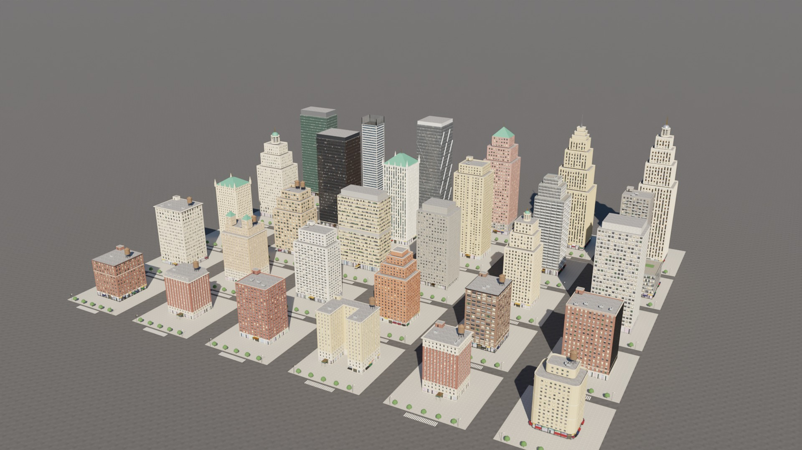
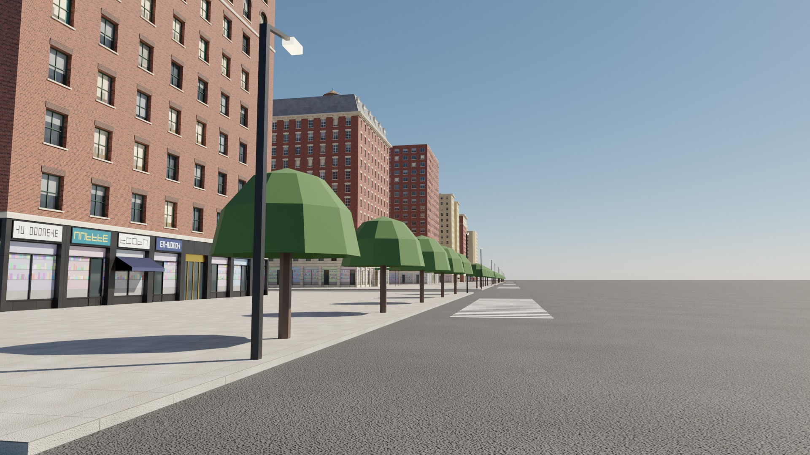
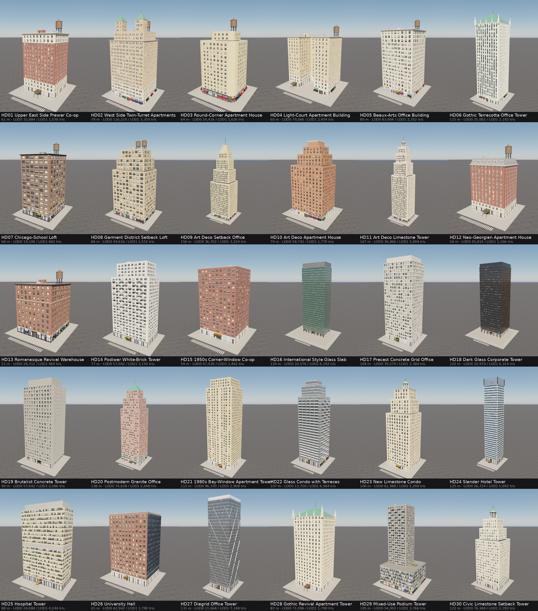

# Manhattan HD Kit: 30 realistic mid/high-rise buildings





30 detailed, realistic Manhattan building types in the **51–167 m** range, the main
height band for web-swinging and parkour traversal. Each one has real 3D facade detail, not flat
textures on a box:

- **Windows set into the wall** with depth (0.15–0.75 m), plus frames, mullions, stone sills and lintels.
  There are also keystones, arched heads with stone voussoirs, and paired and three-part windows.
- **Window air-conditioners** on prewar and postwar apartment buildings.
- **Art Deco vertical strips** with recessed metal spandrels between projecting piers.
- **Glass curtain walls** with mullion fins and spandrel bands, plus ribbon windows and a diagrid.
- **Storefront bases:** stone or cast-iron piers, bulkheads, display windows with varied shop interiors,
  sign bands, transoms, doors, fabric awnings, and lobby entrances with canopies.
- **Layered cornices with brackets**, horizontal stone bands, parapets with stone caps, and setback terraces.
- **Crowns and rooftops:** copper turrets, ziggurats, colonnaded lanterns, a mansard with dormers,
  Gothic pinnacles, mechanical screens, wooden water towers on braced steel stands, air-conditioning units
  and stair bulkheads.
- **Realistic materials:** every masonry, stone, concrete and metal surface has color, normal and roughness
  maps (brick with recessed mortar, rusticated limestone, glazed terracotta, polished granite,
  board-formed concrete, brushed aluminum, copper patina).
- **Varied interiors behind the glass:** windows draw on 4×4 interior atlases (rooms, offices, shops), so each
  window shows a different room, with blinds, curtains or lights on.



## Files

| Path | Contents |
|---|---|
| `models/hdNN_*.gltf` + `.bin` | One glTF per building, containing **two meshes**: `*_LOD0` (full detail) and `*_LOD1` (distance version). |
| `models/textures/` | Shared texture set used by all 30 models (JPEG, 1024²). |
| `manhattan_hd_kit.blend` | All 30 on a street grid with sidewalks, trees, streetlights and sky lighting. Textures are packed. |
| `previews/` | 1000×1250 beauty render of each building. |
| `catalog.json` | Metadata: size, triangle counts, materials. |

## Specs

- **Units:** metres. **Pivot:** footprint centre at ground level. **Front:** −Y in Blender (+Z in glTF/Unity/Godot).
- **LOD0:** 10,576–116,210 triangles (median 46,622), for close-up and hero views.
- **LOD1:** 682–7,148 triangles (median 2,417). Flat walls, windows as textured quads, no frames or brackets. Use it beyond about 150 m.
- **Materials:** glTF PBR metallic/roughness with normal maps. Surface textures tile in world space (brick ≈ 1.2 m per tile).
- **Engine notes:**
  - Unity: import with glTFast. Rename the meshes to `_LOD0`/`_LOD1` on a LOD Group, or split them into prefabs.
  - Unreal: use the glTF importer.
  - Godot: import the `.gltf` directly.
  - Keep `models/textures/` next to the `.gltf` files.
- **Not included:** interiors, collision meshes (box colliders per tier work well), LOD2/impostors, night emission maps.

## Catalog

| # | Building | W×D×H (m) | LOD0 tris | LOD1 tris | File |
|---|---|---|---|---|---|
| HD01 | **Upper East Side Prewar Co-op** — 15-storey red-brick co-op: rusticated limestone base, arched top floors, grand bracketed cornice, water tower. | 32×33×61 | 32,884 | 1,078 | [`hd01_ues_prewar_coop.gltf`](models/hd01_ues_prewar_coop.gltf) |
| HD02 | **West Side Twin-Turret Apartments** — 21-storey tan brick apartment house with paired windows and two copper-roofed rooftop turrets. | 39×33×79 | 116,210 | 3,350 | [`hd02_uws_twin_turret.gltf`](models/hd02_uws_twin_turret.gltf) |
| HD03 | **Round-Corner Apartment House** — 15-storey buff-brick building with rounded corners and shops wrapping the base. | 37×31×64 | 26,416 | 1,626 | [`hd03_rounded_corner_apartments.gltf`](models/hd03_rounded_corner_apartments.gltf) |
| HD04 | **Light-Court Apartment Building** — U-plan 15-storey building around a front light court, limestone base, cornices. | 47×37×60 | 79,066 | 2,454 | [`hd04_lightcourt_apartments.gltf`](models/hd04_lightcourt_apartments.gltf) |
| HD05 | **Beaux-Arts Office Building** — 17-storey limestone office: rusticated arched base, paired windows, arcaded top, grand cornice. | 41×36×80 | 83,904 | 2,352 | [`hd05_beaux_arts_office.gltf`](models/hd05_beaux_arts_office.gltf) |
| HD06 | **Gothic Terracotta Office Tower** — 25-storey cream terracotta tower with soaring piers, green spandrels and a pinnacled copper crown. | 35×33×115 | 25,082 | 2,192 | [`hd06_gothic_terracotta_office.gltf`](models/hd06_gothic_terracotta_office.gltf) |
| HD07 | **Chicago-School Loft** — 14-storey brick loft with wide three-part windows, piers and a metal cornice. | 32×36×68 | 19,106 | 682 | [`hd07_chicago_school_loft.gltf`](models/hd07_chicago_school_loft.gltf) |
| HD08 | **Garment District Setback Loft** — 18-storey tan-brick loft with factory windows, two setbacks and twin water towers. | 43×31×86 | 49,616 | 1,552 | [`hd08_garment_district_loft.gltf`](models/hd08_garment_district_loft.gltf) |
| HD09 | **Art Deco Setback Office** — 32-storey buff-brick deco tower: vertical piers, dark spandrels, four setbacks and a ziggurat crown. | 45×40×156 | 36,702 | 3,224 | [`hd09_art_deco_office.gltf`](models/hd09_art_deco_office.gltf) |
| HD10 | **Art Deco Apartment House** — 20-storey orange-brick apartments with corner windows and stepped terraces. | 37×31×70 | 58,742 | 1,770 | [`hd10_art_deco_apartments.gltf`](models/hd10_art_deco_apartments.gltf) |
| HD11 | **Art Deco Limestone Tower** — 36-storey limestone tower with bronze spandrels, setbacks and a colonnaded lantern crown. | 39×35×167 | 36,466 | 3,494 | [`hd11_art_deco_limestone_tower.gltf`](models/hd11_art_deco_limestone_tower.gltf) |
| HD12 | **Neo-Georgian Apartment House** — 12-storey red brick with white multi-pane windows, keystone lintels and a mansard roof. | 34×32×56 | 45,814 | 1,166 | [`hd12_neo_georgian_apartments.gltf`](models/hd12_neo_georgian_apartments.gltf) |
| HD13 | **Romanesque Revival Warehouse** — 10-storey warehouse with arched upper floors, brick cornice and cast-iron storefronts. | 35×38×51 | 28,312 | 960 | [`hd13_romanesque_warehouse.gltf`](models/hd13_romanesque_warehouse.gltf) |
| HD14 | **Postwar White-Brick Tower** — 24-storey white-brick apartment tower with balconies and a setback. | 41×27×77 | 57,042 | 3,150 | [`hd14_postwar_white_brick.gltf`](models/hd14_postwar_white_brick.gltf) |
| HD15 | **1950s Corner-Window Co-op** — 18-storey red-brick co-op with corner windows and aluminium frames. | 35×31×59 | 47,430 | 1,462 | [`hd15_fifties_corner_window_coop.gltf`](models/hd15_fifties_corner_window_coop.gltf) |
| HD16 | **International Style Glass Slab** — 31-storey green curtain-wall slab on pilotis over a granite plaza. | 70×51×124 | 10,576 | 6,192 | [`hd16_international_style_slab.gltf`](models/hd16_international_style_slab.gltf) |
| HD17 | **Precast Concrete Grid Office** — 25-storey office with deep-set windows in a precast concrete grid. | 40×35×104 | 70,574 | 2,380 | [`hd17_precast_grid_office.gltf`](models/hd17_precast_grid_office.gltf) |
| HD18 | **Dark Glass Corporate Tower** — 29-storey dark glass and bronze tower with a colonnaded plaza base. | 63×55×122 | 10,970 | 6,314 | [`hd18_dark_glass_office.gltf`](models/hd18_dark_glass_office.gltf) |
| HD19 | **Brutalist Concrete Tower** — 23-storey board-formed concrete tower with deep windows and heavy piers on pilotis. | 37×32×90 | 57,642 | 2,086 | [`hd19_brutalist_tower.gltf`](models/hd19_brutalist_tower.gltf) |
| HD20 | **Postmodern Granite Office** — 30-storey pink granite office with arched base, setbacks and a copper pyramid crown. | 39×36×138 | 74,638 | 2,648 | [`hd20_postmodern_granite_office.gltf`](models/hd20_postmodern_granite_office.gltf) |
| HD21 | **1980s Bay-Window Apartment Tower** — 35-storey brick tower with full-height projecting bay windows. | 36×33×113 | 96,330 | 2,908 | [`hd21_eighties_bay_window_tower.gltf`](models/hd21_eighties_bay_window_tower.gltf) |
| HD22 | **Glass Condo with Terraces** — 31-storey glass condo with wraparound balconies and terraced setbacks. | 35×31×107 | 13,720 | 6,584 | [`hd22_glass_condo_terraces.gltf`](models/hd22_glass_condo_terraces.gltf) |
| HD23 | **New Limestone Condo** — 24-storey contemporary limestone condo with setback terraces and a lantern crown. | 30×31×100 | 61,988 | 2,208 | [`hd23_new_prewar_limestone.gltf`](models/hd23_new_prewar_limestone.gltf) |
| HD24 | **Slender Hotel Tower** — 35-storey white-panel hotel with ribbon windows and a finned crown. | 23×26×125 | 26,724 | 5,692 | [`hd24_slender_hotel.gltf`](models/hd24_slender_hotel.gltf) |
| HD25 | **Hospital Tower** — 20-storey medical tower with ribbon windows, mechanical floor and drop-off canopy. | 52×34×88 | 24,088 | 4,244 | [`hd25_hospital_tower.gltf`](models/hd25_hospital_tower.gltf) |
| HD26 | **University Hall** — 15-storey academic building, brick with a glass curtain-wall side. | 40×34×65 | 42,942 | 1,790 | [`hd26_university_hall.gltf`](models/hd26_university_hall.gltf) |
| HD27 | **Diagrid Office Tower** — 31-storey silver glass tower wrapped in a diagonal steel grid. | 35×38×131 | 11,668 | 7,148 | [`hd27_diagrid_office.gltf`](models/hd27_diagrid_office.gltf) |
| HD28 | **Gothic Revival Apartment Tower** — 21-storey terracotta apartment tower with arched top floors and pinnacled crown. | 32×34×82 | 71,096 | 1,790 | [`hd28_gothic_apartment_tower.gltf`](models/hd28_gothic_apartment_tower.gltf) |
| HD29 | **Mixed-Use Podium Tower** — 5-storey retail/office podium with a 24-storey residential tower and roof terrace. | 51×43×105 | 54,002 | 3,766 | [`hd29_podium_tower.gltf`](models/hd29_podium_tower.gltf) |
| HD30 | **Civic Limestone Setback Tower** — 24-storey municipal-style limestone tower with arcaded base and lantern crown. | 41×35×122 | 76,348 | 2,782 | [`hd30_civic_setback_tower.gltf`](models/hd30_civic_setback_tower.gltf) |

## Regenerate / tweak

```bash
python3 generator/hd/hd_textures.py hd/textures         # PBR textures + window atlases (~50 s)
python3 generator/hd/hd_generate.py --out hd            # glTF + previews (~2 min per building at 48 samples)
python3 generator/hd/hd_generate.py --out hd --only 9 --no-render   # re-export one building
python3 generator/hd/hd_package.py hd                   # contact sheet + catalog.json
python3 generator/hd/hd_overview.py --out hd            # .blend + aerial + street-level renders
```

- `generator/hd/hd_builder.py` is the facade engine: window units, curtain walls, storefronts, cornice profiles and rooftop equipment.
- `generator/hd/hd_catalog.py` holds the 30 buildings as specs: a base, then tiers (footprint, floors, facade style, trim), then a crown and roof. A new building is about 15 lines.
